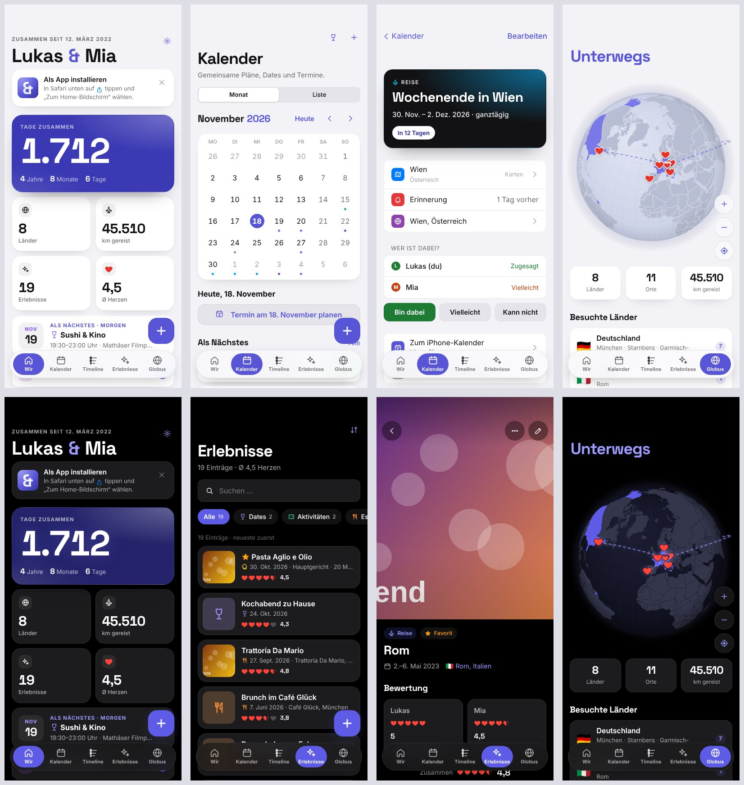

# Couple Journal

Euer gemeinsames Journal fürs iPhone: Dates, Aktivitäten, Essen, selbst gekochte Rezepte, Reisen und Geschenke festhalten und **jeder für sich mit Herzen bewerten**. Dazu kommen ein **Kalender** zum Planen, Fotos, ein **Globus** mit allen Orten, an denen ihr wart, eine **Timeline** ab Tag 1 und eine **Galerie**. Die App liegt wie eine echte App auf dem Home-Bildschirm – standardmäßig in **Nachtblau & Gold**, hell oder dunkel passend zum iPhone.



## Funktionen

| | |
|---|---|
| **Startseite** | Großer Tage-Zähler, Kacheln mit Ländern, Kilometern, Erlebnissen und Ø-Bewertung, der nächste Termin, Countdowns (Jahrestag, Geburtstage, Valentinstag, Weihnachten, eigene Tage), „Heute vor X Jahren“ und ein Fun Fact aus euren eigenen Daten. |
| **Kalender** | Treffen planen mit Datum, Uhrzeit (von–bis) oder ganztägig, Ort, Notizen und Kategorie. Monats- und Listenansicht, Geburtstage und Jahrestage stehen automatisch drin. Termine lassen sich **wiederholen**, jeder kann **zusagen, absagen oder „vielleicht“** sagen, und mit einem Tipp landet ein Termin samt **Erinnerung im iPhone-Kalender**. Nach dem Treffen wird daraus ein bewertbares Erlebnis. |
| **Date-Planer** | Die Startseite meldet sich, wenn euer letztes Date länger her ist als euer Rhythmus (wöchentlich, alle 2 Wochen, monatlich – unter Einstellungen) oder wenn ein Jahrestag oder Geburtstag ansteht. Sie schlägt freie Abende aus eurem Kalender und eine Idee vor; „Planen“ trägt das Date mit einem Tipp in den Kalender ein. |
| **Zufalls-Date** | Fast 70 Date-Ideen plus eure eigenen (Bucket-Liste, Restaurants mit „Wieder hin“, Rezepte mit „Nochmal kochen“). Filter für Tag, zu Hause/unterwegs, Budget, Dauer und Stimmung; für Heute, Morgen oder das Wochenende wird das **Wetter** berücksichtigt (bei Regen nur Ideen für drinnen). |
| **Listen** | Gemeinsame To-dos und Einkaufsliste mit **Zuweisung**: „Du kümmerst dich um …“, „Mia kümmert sich um …“ oder „Wer hat Zeit?“. Mit Fälligkeitsdatum, Abhaken auf beiden iPhones gleichzeitig und Hinweis, wenn dir etwas zugewiesen wurde. Zutaten aus einem Rezept landen mit einem Tipp – auf die gewählte Portionszahl umgerechnet – im Einkauf. |
| **Erlebnisse bewerten** | Dates, Aktivitäten, Essen, Rezepte, Reisen und Geschenke. Jeder vergibt 1–5 Herzen (auch halbe) und einen Kommentar, der Durchschnitt wird automatisch berechnet. Je Kategorie gibt es passende Felder, z. B. „Wieder hin?“ beim Essen. |
| **Rezepte** | Selbst Gekochtes mit Fotos, Bewertung, Zutaten, Zubereitung, Tipps und Quelle. Zutaten und Schritte lassen sich abhaken und **auf andere Portionen umrechnen**; der **Kochmodus** hält den Bildschirm an. |
| **Filme & Serien** | Gemeinsam Geschautes bewerten (Film, Serie, Doku, Anime; Plattform, Genre, Staffel, „Empfehlen?“). Die **Watchlist** läuft über die Bucket-Liste, „Was schauen wir heute?“ wählt per Zufall – und taucht auch bei den Date-Ideen auf. |
| **Wunschzettel** | Jeder pflegt Wünsche mit Link, Preis und „Wie sehr?“ – der andere sieht sie. „Besorg ich“-Markierungen und **geheime Geschenkideen** bleiben nur auf dem eigenen iPhone und werden nie hochgeladen. Aus einer Idee wird mit einem Tipp ein Geschenk-Eintrag. |
| **Fotos & Galerie** | Mehrere Fotos pro Eintrag; Aufnahmedatum und Ort kommen automatisch aus dem Foto. Die Galerie sortiert nach Monaten, mit Favoriten, Filtern und Vollbild. |
| **Globus** | Zum Drehen und Zoomen. Besuchte Länder leuchten, Herzen markieren eure Orte, Bögen führen von eurem Zuhause zu jeder Reise. Dazu Länder, Orte und Kilometer. |
| **Timeline** | Ab Tag 1: Meilensteine mit Fotos, alle Erlebnisse und automatische Jahrestage sowie runde Tageszahlen. |
| **Bucket-Liste** | Was ihr noch machen wollt. Erledigt wird daraus ein Erlebnis; „Zufall: Was machen wir?“ wählt einen offenen Wunsch aus. |
| **Briefe** | Nachrichten aneinander, auch als **Zeitkapsel**, die sich erst ab einem Datum öffnen lässt. |
| **Statistik** | Eure Zahlen, Bestenlisten und eure Aktivität pro Monat. |
| **Geschmacks-Duell & Rangliste** | Wie einig seid ihr euch (in %), wer bewertet strenger, eure Lieblingskategorien und die umstrittensten Erlebnisse. Dazu eine **Rangliste** von S bis D – insgesamt oder pro Kategorie. |
| **Erfolge & Serien** | 18 Abzeichen in Bronze, Silber und Gold (Länder, Kilometer, Restaurants, Rezepte, Filme, Fotos, „Ein Herz und eine Seele“ …) und eure Serie: Monate in Folge mit mindestens einem Erlebnis. Neue Stufen werden mit Konfetti gemeldet. |
| **Farbwelten** | Nachtblau & Gold (Standard), Petrol & Koralle, Indigo, Polaroid oder Schwarz & Neon – unter Einstellungen → Farbwelt, für jedes iPhone einzeln. „Automatisch“ folgt dem Hell-/Dunkelmodus des iPhones. |
| **Sync & offline** | Beide iPhones sehen dieselben Daten. Die App funktioniert ohne Netz und überträgt Änderungen später. Dazu gibt es ein Backup als Datei. |

---

## Einrichten (einmalig, ca. 20 Minuten)

### 1. App online stellen (GitHub Pages, kostenlos)

1. Den Pull Request in `main` mergen.
2. GitHub → **Settings → General** → ganz unten **Change repository visibility → Public**.
   *Öffentlich wird nur der Programmcode. Eure Einträge und Fotos liegen nie im Repository.*
3. **Settings → Pages** → bei *Build and deployment* als **Source: „GitHub Actions“** wählen.
4. Unter **Actions** den Workflow „App auf GitHub Pages veröffentlichen“ starten (*Run workflow*). Danach läuft er nach jeder Änderung an `main` automatisch.
5. Die App ist danach erreichbar unter **https://lukas1210.github.io/claude-/**

> Tipp: Wenn du das Repository z. B. in `couple-journal` umbenennst, wird die Adresse schöner: `https://lukas1210.github.io/couple-journal/`

### 2. Sync einrichten (Supabase, kostenlos)

Damit ihr beide alles auf euren iPhones seht:

1. Auf [supabase.com](https://supabase.com) registrieren → **New project**.
   - Name: `couple-journal`
   - Region: *Frankfurt (eu-central-1)*
   - Datenbank-Passwort: frei wählen
2. **SQL Editor → New query** → den Inhalt von [`supabase/setup.sql`](supabase/setup.sql) einfügen → **Run**.
3. **Authentication → Users → Add user → Create new user**.
   - Ein Konto für dich und eins für deine Freundin anlegen (E-Mail + Passwort).
   - Jeweils „Auto Confirm User“ anhaken.
4. Im SQL-Editor das Skript noch einmal ausführen. Dadurch werden die beiden Konten freigeschaltet, und die Abfrage am Ende zeigt eure zwei E-Mail-Adressen.
5. **Authentication → Sign In / Providers** → **„Allow new users to sign up“ ausschalten**. So kann sich niemand sonst registrieren.
6. **Project Settings → API Keys** bzw. **API**:
   - Die **Project URL** und den **anon public** (oder **publishable**) Key kopieren.
   - Beides in [`app/config.js`](app/config.js) eintragen (auf GitHub: Datei öffnen → ✏️ → Commit). Alternativ kann man beides in der App unter Einstellungen → Synchronisation eingeben.

### 3. Auf eure iPhones

1. Die Adresse aus Schritt 1 in **Safari** öffnen.
2. Unten auf **Teilen** <sup>⬆︎</sup> → **„Zum Home-Bildschirm“** → **Hinzufügen**. Hier kannst du den Namen unter dem Icon auch anpassen.
3. Die App vom Home-Bildschirm aus öffnen:
   - **Du:** „Loslegen“ → Namen und euren Tag 1 eintragen → dann unter **Einstellungen → Synchronisation** anmelden.
   - **Deine Freundin:** „Mit Partner verbinden“ → mit ihrem Konto anmelden → „Wer bist du?“ auswählen.

---

## Gut zu wissen

- **Wo liegen die Daten?** Auf dem iPhone und, mit Sync, in eurem eigenen, privaten Supabase-Projekt.
  - Für alles gilt: Lesen und Schreiben ist nur mit einem eurer beiden Logins möglich.
  - Ortssuchen gehen an OpenStreetMap.
- **Offline:** Die App startet auch ohne Netz. Änderungen werden übertragen, sobald wieder Verbindung besteht.
- **Supabase Free:** Ein Projekt wird nach ca. einer Woche ohne Nutzung pausiert.
  - Im Supabase-Dashboard mit einem Klick auf „Restore“ wieder starten. Es geht nichts verloren.
  - Der kostenlose Speicher (1 GB) reicht für ungefähr 2.500 Fotos.
- **Backup:** Unter Einstellungen → Backup könnt ihr alles inklusive Fotos als Datei sichern, z. B. in „Dateien“ oder iCloud Drive.
- **Wetter** für die Date-Ideen kommt von Open-Meteo. Dafür werden nur die Koordinaten eures Zuhauses (oder des aktuellen Standorts, wenn ihr das erlaubt) übertragen.
- **Zeitkapseln** sind eine Sperre in der App, keine Verschlüsselung.
- **Termin-Erinnerungen** kommen vom iPhone-Kalender. Dafür im Termin auf „Zum iPhone-Kalender hinzufügen“ tippen. Eigene Push-Mitteilungen der App bräuchten einen Server.
- **Updates:** Nach einer neuen Version zeigt die App „Neue Version verfügbar“. Ein Tipp darauf genügt.

---

## Für Entwickler

Reines HTML, CSS und JavaScript ohne Build-Schritt. Bibliotheken liegen in `app/vendor/`: d3-geo, topojson, supabase-js und die Schrift Space Grotesk (für Titel und Zahlen; Fließtext nutzt SF Pro).

```bash
cd app && python3 -m http.server 8000   # lokal starten → http://localhost:8000
node tools/e2e/run.cjs                   # End-to-End-Tests im iPhone-Format (Playwright/Chromium)
node tools/e2e/run.cjs tour palettes     # Screenshot-Rundgang & Farbwelt-Vorschau → tools/e2e/shots/
node tools/test-sync.mjs                 # Sync-Tests mit zwei simulierten iPhones
node tools/test-insights.mjs             # Unit-Tests: Auswertungen, Erfolge, Ideen, Wetter
python3 tools/palettes/generate.py       # Farbwelten prüfen (Kontraste) und css/palettes.css erzeugen
node tools/make-icons.mjs                # App-Icon & iOS-Startbilder neu erzeugen
node tools/update-sw.mjs                 # Offline-Dateiliste im Service Worker aktualisieren
```

```
app/
  index.html, manifest.webmanifest, sw.js, config.js
  css/app.css               Design-System (hell & dunkel, Standard-Tokens)
  css/palettes.css          Farbwelten (erzeugt mit tools/palettes)
  js/main.js                Start, Tab-Leiste, „+“-Menü, Service Worker
  js/theme.js               Hell/Dunkel/Automatisch und Farbwelt
  js/insights.js            Auswertungen: Reisen, Bewertungen, Fun Facts
  js/events.js              Termine: Wiederholungen, besondere Tage, iPhone-Kalender (.ics)
  js/recipe.js              Rezepte: Zutaten umrechnen, Schritte, Kochmodus
  js/store.js, db.js        Daten (IndexedDB, offline first)
  js/sync.js                Supabase-Sync (Push/Pull, Fotos, Realtime)
  js/photos.js, exif.js     Fotos komprimieren, EXIF lesen, lazy laden
  js/views/*.js             Bildschirme (Start, Kalender, Timeline, Erlebnisse, Globus, Galerie …)
supabase/setup.sql          Datenbank, Rechte, Foto-Speicher
.github/workflows/pages.yml Veröffentlichung auf GitHub Pages
```
