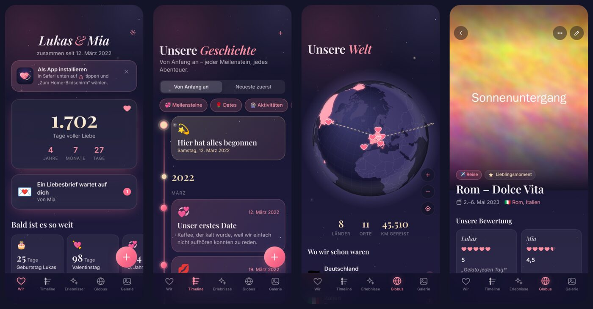

# Couple Journal 💞

Euer gemeinsames Tagebuch fürs iPhone: Dates, Aktivitäten, Essen, Reisen und Geschenke festhalten und **jeder für sich mit Herzen bewerten**. Dazu gibt es Fotos, einen **Globus** mit allen Orten, an denen ihr wart, eine **Timeline** ab eurem ersten Tag und eine **Galerie**. Die App liegt wie eine echte App auf dem Home-Bildschirm.



## Funktionen

| | |
|---|---|
| 🌹 **Erlebnisse bewerten** | Dates, Aktivitäten, Essen, Reisen und Geschenke. Jeder von euch vergibt 1–5 Herzen (auch halbe) und einen Kommentar. Der Durchschnitt wird automatisch berechnet. |
| 🍝 **Passende Felder je Kategorie** | Beim Essen: Küche, Lieblingsgericht, Preis und „Wieder hin?“. Beim Geschenk: von wem an wen und der Anlass. Bei der Reise: Zeitraum, Anreise und Highlights. |
| 📸 **Fotos** | Mehrere Fotos pro Erinnerung, eins davon als Titelbild. Aufnahmedatum und Ort werden automatisch aus dem Foto übernommen. Die Fotos werden verkleinert, damit sie wenig Speicher brauchen. |
| 🌍 **Globus** | Zum Drehen und Zoomen. Besuchte Länder leuchten rosé, Herzen markieren eure Orte, und Bögen führen von eurem Zuhause zu jeder Reise. Dazu kommt eine Statistik mit Ländern, Orten und Kilometern. |
| 💫 **Timeline** | Startet bei „Hier hat alles begonnen“ und zeigt eigene Meilensteine mit Fotos, alle Erlebnisse sowie automatische Jahrestage und Marken wie 100 oder 1.000 Tage. |
| 🖼️ **Galerie** | Alle Fotos nach Monaten sortiert, mit Favoriten und Filtern. In der Vollbildansicht könnt ihr wischen und zoomen und ein Foto direkt in „Fotos“ sichern. |
| ⏳ **Startseite** | Zeigt, seit wie vielen Tagen ihr zusammen seid. Dazu kommen Countdowns (Jahrestag, Geburtstage, Valentinstag, eigene Tage), „Heute vor X Jahren“ und eine Erinnerung des Tages. |
| 🌠 **Bucket-Liste** | Gemeinsame Wünsche. Abgehakt werden sie zu einer Erinnerung. Der Knopf „Überrasch uns!“ wählt einen zufälligen Wunsch aus. |
| 💌 **Liebesbriefe** | Kleine Briefe an den Partner, auch als **Zeitkapsel**, die sich erst ab einem bestimmten Datum öffnen lässt. |
| 📊 **Statistik** | Wer bewertet strenger? Wie einig seid ihr euch? Dazu Bestenlisten und eure Aktivität pro Monat. |
| ☁️ **Sync & offline** | Beide iPhones sehen dieselben Daten. Die App funktioniert auch ohne Netz und überträgt Änderungen später. Dazu gibt es ein Backup als Datei. |

---

## Einrichten (einmalig, ca. 20 Minuten)

### 1. App online stellen (GitHub Pages, kostenlos)

1. Den Pull Request in `main` mergen.
2. GitHub → **Settings → General** → ganz unten **Change repository visibility → Public**.
   *Öffentlich wird nur der Programmcode. Eure Erinnerungen und Fotos liegen nie im Repository.*
3. **Settings → Pages** → bei *Build and deployment* als **Source: „GitHub Actions“** wählen.
4. Unter **Actions** den Workflow „App auf GitHub Pages veröffentlichen“ starten (*Run workflow*). Danach läuft er nach jeder Änderung an `main` automatisch.
5. Die App ist danach erreichbar unter **https://lukas1210.github.io/claude-/**

> Tipp: Wenn du das Repository z. B. in `couple-journal` umbenennst, wird die Adresse schöner: `https://lukas1210.github.io/couple-journal/`

### 2. Sync einrichten (Supabase, kostenlos)

Damit ihr beide alles auf euren iPhones seht:

1. Auf [supabase.com](https://supabase.com) registrieren → **New project**.
   - Name: `couple-journal`
   - Region: *Frankfurt (eu-central-1)*
   - Datenbank-Passwort: frei wählen
2. **SQL Editor → New query** → den Inhalt von [`supabase/setup.sql`](supabase/setup.sql) einfügen → **Run**.
3. **Authentication → Users → Add user → Create new user**.
   - Ein Konto für dich und eins für deine Freundin anlegen (E-Mail + Passwort).
   - Jeweils „Auto Confirm User“ anhaken.
4. Im SQL-Editor das Skript noch einmal ausführen. Dadurch werden die beiden Konten freigeschaltet, und die Abfrage am Ende zeigt eure zwei E-Mail-Adressen.
5. **Authentication → Sign In / Providers** → **„Allow new users to sign up“ ausschalten**. So kann sich niemand sonst registrieren.
6. **Project Settings → API Keys** bzw. **API**:
   - Die **Project URL** und den **anon public** (oder **publishable**) Key kopieren.
   - Beides in [`app/config.js`](app/config.js) eintragen (auf GitHub: Datei öffnen → ✏️ → Commit). Alternativ kann man beides in der App unter Einstellungen → Synchronisation eingeben.

### 3. Auf eure iPhones

1. Die Adresse aus Schritt 1 in **Safari** öffnen.
2. Unten auf **Teilen** <sup>⬆︎</sup> → **„Zum Home-Bildschirm“** → **Hinzufügen**. Hier kannst du den Namen unter dem Icon auch anpassen.
3. Die App vom Home-Bildschirm aus öffnen:
   - **Du:** „Unsere Geschichte beginnen“ → Namen und euren Tag eintragen → dann unter **Einstellungen → Synchronisation** anmelden.
   - **Deine Freundin:** „Mit Partner verbinden“ → mit ihrem Konto anmelden → „Wer bist du?“ auswählen.

---

## Gut zu wissen

- **Wo liegen die Daten?** Auf dem iPhone und, mit Sync, in eurem eigenen, privaten Supabase-Projekt.
  - Für alles gilt: Lesen und Schreiben ist nur mit einem eurer beiden Logins möglich.
  - Ortssuchen gehen an OpenStreetMap.
- **Offline:** Die App startet auch ohne Netz. Änderungen werden übertragen, sobald wieder Verbindung besteht.
- **Supabase Free:** Ein Projekt wird nach ca. einer Woche ohne Nutzung pausiert.
  - Im Supabase-Dashboard mit einem Klick auf „Restore“ wieder starten. Es geht nichts verloren.
  - Der kostenlose Speicher (1 GB) reicht für ungefähr 2.500 Fotos.
- **Backup:** Unter Einstellungen → Backup könnt ihr alles inklusive Fotos als Datei sichern, z. B. in „Dateien“ oder iCloud Drive.
- **Zeitkapseln** sind eine Sperre in der App, keine Verschlüsselung.
- **Updates:** Nach einer neuen Version zeigt die App „Neue Version verfügbar“. Ein Tipp darauf genügt.

---

## Für Entwickler

Reines HTML, CSS und JavaScript ohne Build-Schritt. Bibliotheken liegen in `app/vendor/`: d3-geo, topojson und supabase-js.

```bash
cd app && python3 -m http.server 8000   # lokal starten → http://localhost:8000
node tools/test-sync.mjs                 # Sync-Tests mit zwei simulierten iPhones (Playwright)
node tools/make-icons.mjs                # App-Icon & iOS-Startbilder neu erzeugen
```

```
app/
  index.html, manifest.webmanifest, sw.js, config.js
  css/app.css               Design-System (Nachtblau & Rosé)
  js/main.js                Start, Tab-Leiste, „+“-Menü, Service Worker
  js/store.js, db.js        Daten (IndexedDB, offline first)
  js/sync.js                Supabase-Sync (Push/Pull, Fotos, Realtime)
  js/photos.js, exif.js     Fotos komprimieren, EXIF lesen, lazy laden
  js/views/*.js             Bildschirme (Start, Timeline, Erlebnisse, Globus, Galerie …)
supabase/setup.sql          Datenbank, Rechte, Foto-Speicher
.github/workflows/pages.yml Veröffentlichung auf GitHub Pages
```
